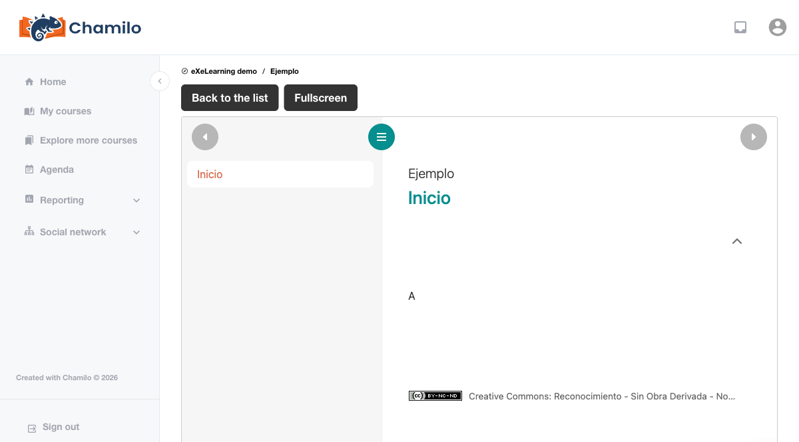

# eXeLearning for Chamilo

Upload, view and edit [eXeLearning](https://exelearning.net) v4 packages (`.elpx`) inside Chamilo LMS courses.



The Chamilo member of the eXeLearning integrations family, alongside
[WordPress](https://github.com/exelearning/wp-exelearning),
[Moodle](https://github.com/exelearning/mod_exelearning),
[Omeka S](https://github.com/exelearning/omeka-s-exelearning) and
[Nextcloud](https://github.com/exelearning/nextcloud-exelearning).

## What it does

- Adds an **eXeLearning** tool to every course. Teachers upload `.elpx` packages; students open them in the course.
- Validates every package before storing it. Damaged archives, unsafe file names, symbolic links, zip bombs and legacy `.elp`
  files are rejected with a clear message.
- Keeps packages in Chamilo's private plugin storage (local disk or the remote storage configured for Chamilo) and serves them
  only to users of the course, through the plugin, with strict response headers.
- Lets teachers create and edit packages with the **embedded eXeLearning editor**, without leaving Chamilo. A save never replaces a
  good package with a broken one, and two teachers cannot silently overwrite each other. The editor can be turned off for
  "player only" installations.
- Rename, show/hide, download and delete packages. Packages are removed with their course or session.

## Requirements

- Chamilo LMS **3.0** or later (tested with 3.0.2). Chamilo 1.11 is not supported.
- PHP **8.3** or later with the `zip` and `dom` extensions (already required by Chamilo).

## Installation

1. Download `ExeLearning-<version>.zip` from the [releases](https://github.com/exelearning/chamilo-exelearning/releases).
2. Unpack it into `public/plugin/` of your Chamilo installation, so that you get `public/plugin/ExeLearning/plugin.php`.
3. From the Chamilo root, register the plugin classes and clear the cache:

   ```bash
   composer dump-autoload
   php bin/console cache:clear
   ```

4. In **Administration → Plugins**, open the list with `?show_all_plugins=1` appended to the URL (Chamilo hides plugins that
   are not bundled with it), then **install** and **enable** *eXeLearning*. Enabling adds the tool to every course.
5. Optionally open the plugin settings: embedded editor on/off, maximum package size, and who may manage packages.

### Storage and direct access

Packages are stored in Chamilo's `plugins` storage (by default `var/upload/plugins/ExeLearning/`, outside the web root), so
they cannot be reached directly. If you have pointed that storage at a directory under the web root, block it, for example with
nginx:

```nginx
location ^~ /path/to/plugins/ExeLearning/ { deny all; }
```

## Settings

| Setting | Meaning |
|---|---|
| Enable the embedded editor | Off = packages can be uploaded and viewed, not created or edited in Chamilo. |
| Maximum package size (MB) | Empty or 0 = PHP's upload limit. PHP's limit always applies. |
| Who can manage and edit packages | Course teachers (default), teachers and session coaches, or platform administrators only. |
| Default visibility of the tool | Chamilo's standard course-plugin setting. |

## Security model in one paragraph

A package is web content written by its author and runs JavaScript in the browser, so **uploading a package is a trusted
action**: only the roles above can do it. Packages are shown in a sandboxed iframe on the Chamilo origin, served with an explicit
content type, `nosniff`, and a content security policy (script-free for SVG and XML; an opaque origin when a package page is
opened on its own). See [SECURITY.md](SECURITY.md).

## Learning paths and tracking

Not in this first release. Chamilo 3 has no extension point for plugin item types in learning paths. The planned route (export to SCORM 1.2
and import it as a native Chamilo learning path) is described in
[the design document](docs/superpowers/specs/2026-11-16-chamilo-exelearning-design.md).

## Development

See [DEVELOPMENT.md](DEVELOPMENT.md). `make up` starts a complete Chamilo 3 with the plugin installed, demo users, a course and a
sample package. There is no browser playground or PR preview for Chamilo, so try changes locally with `make up`.

## License

[AGPL-3.0-or-later](LICENSE), like the eXeLearning editor it bundles.
